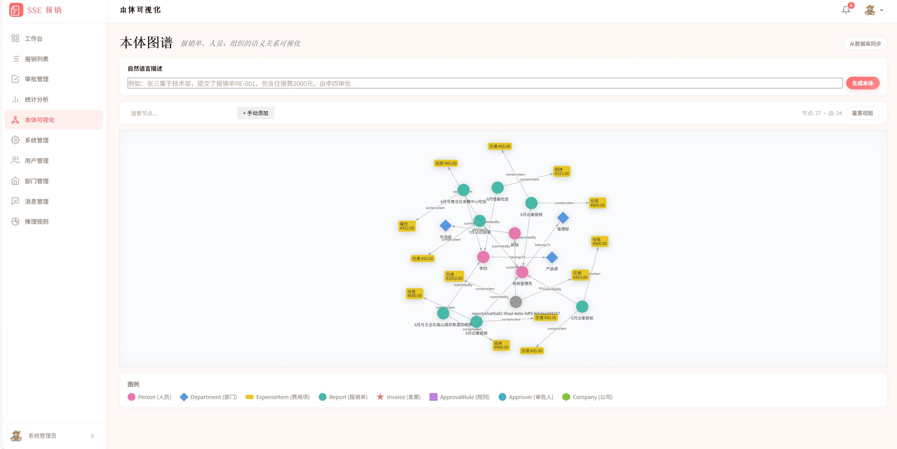
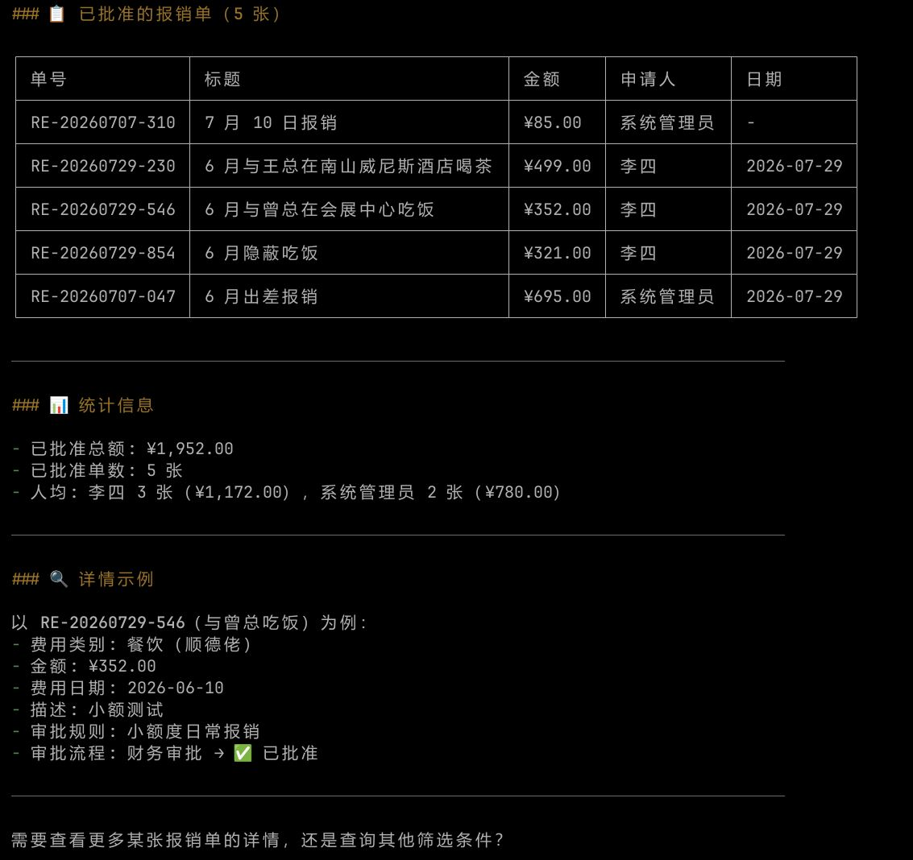

# SSE — Smart Staff Expense / 智能报销管理系统

[](LICENSE) [](https://nodejs.org) [](https://typescriptlang.org) [](https://vuejs.org) [](https://pnpm.io)

<div align="center">

<!-- SSE Logo -->
<svg width="120" height="120" viewBox="0 0 120 120" fill="none" xmlns="http://www.w3.org/2000/svg">
  <defs>
    <linearGradient id="sseGrad" x1="0" y1="0" x2="1" y2="1">
      <stop offset="0%" stop-color="#ff6b6b" />
      <stop offset="100%" stop-color="#ffa94d" />
    </linearGradient>
  </defs>
  <!-- Background -->
  <rect x="4" y="4" width="112" height="112" rx="28" fill="url(#sseGrad)" />
  <!-- Phosphor invoice icon (regular) - white -->
  <g transform="translate(34, 26) scale(3.2)" stroke="#fff" stroke-width="1.5" stroke-linecap="round" stroke-linejoin="round">
    <!-- Document body -->
    <path d="M4 2h11a1 1 0 011 1v18a1 1 0 01-1 1H1a1 1 0 01-1-1V6l4-4z" fill="none" />
    <!-- Fold corner -->
    <path d="M4 2v4H0" fill="none" />
    <!-- Lines -->
    <line x1="4" y1="9" x2="12" y2="9" />
    <line x1="4" y1="13" x2="10" y2="13" />
    <line x1="4" y1="17" x2="8" y2="17" />
  </g>
  <!-- SSE text -->
  <text x="60" y="108" text-anchor="middle" font-family="Georgia, serif" font-size="16" font-weight="700" fill="#fff" opacity="0.85" letter-spacing="2">SSE</text>
</svg>

> AI-powered semantic expense management — **Speak. Scan. Submit.**
> 面向小微团队的智能报销系统：说话、拍照、自动报销。

</div>

---

## ✨ Features / 特性

| Feature | Description |
|---------|-------------|
| 📝 **Smart Reimbursement** | Natural-language expense submission ("张三出差住宿600元") |
| 🖼️ **Invoice OCR** | Upload PDF/OFD invoices, auto-extract data via AI vision models |
| 🧾 **AI Invoice Verification** | Manual AI check of invoice number / amount / date; duplicate invoice detection; approver acknowledgement required on mismatch |
| 🔀 **Configurable Approval** | Multi-step approval chains based on amount & category |
| 💳 **Payment Receipt Verification** | Payment reference or receipt required; async OCR suspicion checks; correction / revert with audit trail; paid reports cannot be deleted |
| 🤖 **Ontology / Knowledge Graph** | Semantic reasoning engine — multi-system data fusion, configurable inference rules, SPARQL cross-domain queries |
| 🧠 **AI Semantic Engine** | LLM-powered entity extraction, category matching, and NL explanation |
| ⚙️ **Admin Engine Setup** | Root URL + API key, model catalog picker, connectivity test, observable OCR test panel with history |
| 📊 **Statistics & Export** | Charts, monthly trends, Excel export |
| 🔔 **Notifications** | In-app + SMS + Email for approval / payment / broadcast events, per-user preferences, delivery tracking and bounce alerts |
| 📡 **MCP Protocol** | 22 tools for AI Agent integration (stdio + Streamable HTTP) |
| 🔗 **SCIM 2.0 + MDM** | External identity sync via SCIM and MDM Webhook |
| 🗂️ **Object Storage** | Invoice files in MinIO, DB holds references only |
| 🔐 **RBAC** | 4 roles with data scope isolation |

---

## 🏗️ Architecture / 架构

Hexagonal Architecture (Ports & Adapters) — core business logic has zero framework dependencies.

```
┌────────────────────────────────────────────────────────┐
│                 Frontend (web/)                         │
│             Vue 3 · Pinia · Vite                        │
└───────────────────────┬────────────────────────────────┘
                        │ HTTP / MCP / SCIM
┌───────────────────────┴────────────────────────────────┐
│               Adapters / 适配器层                        │
│  ┌──────────┐ ┌──────────┐ ┌──────────┐ ┌──────────┐  │
│  │ api/     │ │ mcp/     │ │ ontology/│ │ scim/    │  │
│  │ Express  │ │ JSON-RPC │ │ OWL RDF  │ │ Webhook  │  │
│  └────┬─────┘ └────┬─────┘ └────┬─────┘ └────┬─────┘  │
│       └─────────────┼─────────────┼─────────────┘     │
│                     │             │                     │
│  ┌──────────┐ ┌─────┴─────┐ ┌────┴──────┐             │
│  │ db/      │ │ ocr/      │ │ ai/       │             │
│  │ Postgres │ │ PDF+OFD   │ │ Ollama    │             │
│  └────┬─────┘ └─────┬─────┘ └────┬──────┘             │
└───────┼─────────────┼─────────────┼────────────────────┘
        │             │             │
        └─────────────┼─────────────┘
                      ▼
┌────────────────────────────────────────────────────────┐
│            Domain Core (core/)                           │
│   Entities · Services · Ports — Zero framework deps     │
└────────────────────────────────────────────────────────┘
```

---

## 📦 Tech Stack / 技术栈

| Layer | Technology |
|-------|-----------|
| Frontend | Vue 3 + Vue Router + Pinia + Vite |
| Backend | Node.js + Express + TypeScript |
| Database | PostgreSQL 16 (UUID PKs, JSONB, full-text) |
| File Storage | MinIO (S3-compatible) |
| AI / OCR | OpenAI-compatible LLM (Ollama / Local, optional API key) + MinerU / PaddleOCR |
| Ontology | N3.js + RDF/JS + Custom Reasoner |
| Messaging | SMTP (nodemailer) + Aliyun SMS |
| Protocol | MCP (@modelcontextprotocol/sdk) + SCIM 2.0 |
| Auth | JWT + RBAC (4 roles) |
| Monorepo | pnpm workspaces |

---

## 👥 User Roles / 用户角色

| Role | Permissions |
|------|------------|
| 👤 Employee / 员工 | Create/view own reports, submit from text/voice |
| ✅ Dept. Approver / 部门审批人 | Approve reports from own department |
| 💰 Finance / 财务 | Full-company data, export, payment processing |
| ⚙️ Admin / 管理员 | User/role/rule management, broadcast messages, AI config, MDM setup |

---

## 🚀 Quick Start / 快速启动

### Prerequisites / 环境要求

| Component | Version |
|-----------|---------|
| Node.js | ≥ 18 |
| pnpm | ≥ 9 |
| Docker + Compose | Latest |
| MinIO image | Bundled at `images/minio/` (`sse-minio:local`, `linux/amd64`) |

> **Offline by default / 默认离线部署：** `docker-compose.yml` uses the bundled local image
> `sse-minio:local` instead of pulling `minio/minio` from Docker Hub. Load it once before
> startup — required on air-gapped or internal networks where Docker Hub is unreachable:
>
> ```bash
> gunzip -c images/minio/sse-minio-local.tar.gz | docker load
> ```
>
> **PostgreSQL image:** `postgres:16-alpine` is still pulled from Docker Hub. On air-gapped
> hosts, preload it as described in the [deployment guide §1.4](docs/2026-11-09-sse-deployment.md).

### Setup / 一键启动

```bash
git clone https://github.com/abe87654321/sse.git && cd sse
pnpm install

# MinIO 使用随仓库提供的本地镜像（默认离线场景，无需访问 Docker Hub）
gunzip -c images/minio/sse-minio-local.tar.gz | docker load

docker compose up -d
pnpm build
cp .env.example .env
DB_PORT=5433 pnpm migrate
pnpm dev
```

> **Dev processes:** `pnpm dev` runs `@sse/api`, `@sse/web --host` and `pnpm mcp`
> concurrently. Press `Ctrl+C` once to stop all three.

> If the image was removed by `docker image prune -a` or `docker system prune -a`, reload it
> with the command above before running `docker compose up -d`.
> **Windows PowerShell:** run `tar -xzf images\minio\sse-minio-local.tar.gz` then
> `docker load -i images\minio\sse-minio-local.tar`. Full steps and checksum verification:
> [部署文档 §2.3.1](docs/2026-11-09-sse-deployment.md).

| Service | URL | Port |
|---------|-----|------|
| API | `http://localhost:3000` | 3000 |
| Web | `http://localhost:5173` | 5173 |
| PostgreSQL | `localhost:5433` | 5433 |
| MinIO API | `localhost:9002` | 9002 |
| MinIO Console | `localhost:9003` | 9003 |

> **Default login:** `13800000000` (admin, password `admin123`) — change password after first login.

> **Migrations:** `pnpm migrate` applies every pending SQL migration in order and records
> applied versions in `schema_migrations`; it is safe to re-run on an existing database.
> `pnpm migrate:rollback` requires a matching `*.down.sql`.

---

## 📁 Project Structure / 项目结构

```
sse/
├── packages/
│   ├── shared/          # Shared types, enums, DTOs
│   ├── core/            # Domain core (zero framework dependency)
│   ├── db/              # PostgreSQL repositories & migrations
│   ├── auth/            # JWT + RBAC
│   ├── api/             # Express REST API
│   ├── mcp/             # MCP Server (22 tools)
│   ├── ontology/        # OWL ontology + semantic orchestration engine
│   ├── ocr/             # Invoice OCR (PDF/OFD)
│   ├── ai/              # LLM provider (OpenAI-compatible)
│   ├── notifications/   # SMS/Email + scheduler
│   └── web/             # Vue 3 SPA
├── images/minio/        # Bundled MinIO image (sse-minio:local, offline)
├── docs/                # Design, deployment, process docs
├── docker-compose.yml
└── package.json
```

---

## 🔁 Approval Workflow / 审批流程

```
Draft ──submit──→ Pending ──all approved──→ Approved ──pay──→ Paid
  ↑                  │
  └──save draft───────┼──rejected──→ Rejected ──resubmit──→ Draft
                     │
           48h no approval → reminder
           96h no approval → escalation
```

> Payment requires a payment reference or a receipt (at least one). Receipts are stored in
> MinIO and OCR-checked asynchronously (`pass` / `warning` / `unverified`). Paid reports
> cannot be deleted; finance/admin can correct or revert a payment with an audit trail.

---

## 🤖 Ontology & Semantic Engine / 本体语义引擎

### Why Ontology? / 本体层存在的意义

本体层不是数据库的镜像副本，而是服务于三个数据库无法直接解决的场景：

| 场景 | 说明 | 示例 |
|------|------|------|
| 🔗 **多系统数据融合** | SCIM/MDM 的用户、SSE 的报销单、财务系统的打款记录统一建模，通过 `sse:sameAs` 跨系统关联 | "张三(SCIM)"和"张三(SSE)"是同一人 |
| 🧠 **可配置语义推理** | 管理员定义 IF-THEN 规则，系统自动推导新关系，不依赖硬编码逻辑 | "张三 belongsTo 技术部 + 技术部 partOf 总公司 → 张三 worksFor 总公司" |
| 🔍 **SPARQL 跨域查询** | AI Agent 通过 MCP 用标准 SPARQL 查询跨表、跨系统的复杂关系 | "哪些人经手了同一张发票的所有报销？" |

### Semantic Pipeline / 语义流水线

```
Natural Language / 自然语言
  → EntityExtractor (LLM): {person, amount, category}
  → SemanticMapper: Person → DB userId, category → DB categoryId
  → ActionReasoner: match approval rule, validate
  → ActionExecutor: POST /expenses → submit
  → NL Generator: explainable output
```

### API Endpoints / 端点 (12)

| Endpoint | Description |
|----------|-------------|
| `POST /ontology/submit-from-text` | NL → expense creation |
| `POST /ontology/from-text` | NL → ontology graph (LLM extraction) |
| `GET /ontology/graph` | Full graph (role-scoped) |
| `GET /ontology/sync` | Sync DB → ontology |
| `GET /ontology/query?type=X` | Query by class |
| `PUT /ontology/entity` | Create/update entity |
| `DELETE /ontology/entity?uri=...` | Delete entity |
| `POST /ontology/relation` | Create relation |
| `DELETE /ontology/relation` | Delete relation |
| `POST /ontology/reason` | Trigger reasoning engine |
| `POST /ontology/sparql` | SPARQL cross-domain query |
| `POST /ontology/query-expense-status` | Natural-language filters → expense status query |

### Visualization / 可视化

`/ontology` page — interactive vis-network graph with NL-to-graph generation, manual editing, role-scoped data, and reasoning results overlay.



> 详细设计：[本体层设计](docs/2026-07-26-ontology-design.md) | [本体升级设计](docs/2026-07-29-ontology-upgrade-design.md)

---

## 🔗 MDM & SCIM Integration / 主数据整合

```
External Systems (HR / LDAP / 企业微信)
  ├── SCIM 2.0 ─────────→ [users + identity_mappings]
  └── MDM Webhook ───────→ [users sync]
```

- `POST /scim/Users` — SCIM 2.0 user CRUD
- `POST /webhook/mdm` — MDM event receiver

---

## 📡 MCP Tools / MCP 工具

| Tool | Description |
|------|------------|
| `search_expenses` | Multi-condition search with pagination |
| `get_expense_detail` | Full report detail (items, invoices, approvals) |
| `get_approval_status` | Approval status & history |
| `get_statistics` | Aggregated stats by category/department |
| `get_user_summary` | Per-user expense overview |
| `list_pending_approvals` | Approver's pending queue |
| `submit_expense_from_text` | Natural language → create expense |
| `submit_expense_from_invoice` | Invoice (PDF/OFD) → OCR → create; auto-store + AI verification |
| `query_expense_status` | NL query: "张三这个月报销批了吗" |
| `explain_decision` | Approval chain + rule matching explanation |
| `validate_expense` | Compliance check + suggestions |
| `get_entity_network` | N-hop semantic relationship network |
| `query_ontology` | Query ontology graph by type or full graph |
| `query_sparql` | SPARQL cross-domain query on the ontology graph |
| `approve_expense` | Approve a report (verification acknowledgement supported) |
| `reject_expense` | Reject a report with a required comment |
| `upload_invoice` | Attach a PDF/OFD invoice to a report item |
| `verify_expense` | Run AI invoice verification (amount/date/number + duplicates) |
| `explain_expense` | Evidence chain: rule, approvers, invoices, payment, why blocked |
| `impact_analysis` | What-if impact of rule/category/department changes |
| `find_anomalies` | Amount mismatch, duplicate invoice, missing approver |
| `get_ontology_schema` | Classes/properties available in the ontology TBox |

### 🔌 MCP Transports / 传输

| Transport | Endpoint | Use |
|-----------|----------|-----|
| Streamable HTTP | `POST/GET/DELETE /mcp` | Claude Code / Cursor / VS Code and other MCP clients |
| Legacy HTTP+SSE | `GET /sse` + `POST /messages` | Older clients (`MCP_LEGACY_SSE=0` disables) |
| Health check | `GET /healthz` | Liveness / readiness |

- Non-MCP agent frameworks: `GET /openapi.json` (OpenAPI 3.1); exchange a key via `POST /auth/api-key-login`.
- Start: `MCP_HTTP_PORT=3001 pnpm mcp:http` (stdio remains `pnpm mcp`).
- Auth: `Authorization: Bearer <mcp-api-key>`; identity is resolved per request and bound to the key's user/role/department.
- Optional env: `MCP_JSON_RESPONSE=1`, `MCP_CORS_ORIGIN`, `MCP_MAX_SESSIONS`, `MCP_MAX_BODY_BYTES`.
- systemd unit: `deploy/systemd/sse-mcp.service`.

### 🖥️ Pi Agent Calling MCP Tools / Pi 调用 MCP 工具



> AI agent (Pi) invoking SSE MCP tools via the thin-client extension — natural language expense search, submission, and ontology queries.

---

## 🧬 Ontology v2 / 本体 v2

PostgreSQL remains the system of record. Row triggers append every mapped change
to `ontology_outbox`; the API projector drains it into an embedded Oxigraph
store (real SPARQL 1.1, worker thread with timeout/respawn) and persists versioned
N-Quads snapshots. MCP and Web read the API instead of owning their own graph.

```
Postgres rows ──triggers──▶ ontology_outbox ──GraphProjector──▶ Oxigraph
                 │                                              │
                 └── ontology_graph_snapshots (version/checksum)┘
```

- Named graphs: `urn:sse:tbox`, `urn:sse:data`, `urn:sse:inferred`,
  `urn:sse:history`, `urn:sse:manual`.
- `ONTOLOGY_V2=0` — legacy path only (default).
- `ONTOLOGY_V2=shadow` — v2 routes are mounted and serve reads. Only the legacy
  `SemanticMapper` report writes continue, so the legacy graph stays warm for
  rollback. v2 manual edits go to `urn:sse:manual` and the v2 snapshot and are
  **not** mirrored into the legacy `OwlStore`. A SQL-truth comparator runs every
  5 minutes and exposes the `shadow` field of `GET /ontology/status`
  (admin-only).
- `ONTOLOGY_V2=on` — typed queries, SPARQL, explain/validate/impact/anomalies and
  MCP ontology tools use the v2 graph. `/health` and `/healthz` return `503` when
  the outbox is more than 300s behind.
- **Single API replica required** for `shadow|on`: each API process owns its own
  in-memory graph, so multiple replicas serve divergent/stale graphs unless a
  shared graph store is added. The API logs a startup warning for this.
- Rollback is `ONTOLOGY_V2=0` + restart, then
  `UPDATE ontology_settings SET value='false' WHERE key='outbox_enabled';`.
  Re-run the legacy `GET /ontology/sync` after rollback if you need the legacy
  graph to include edits made through the v2 manual endpoints. The legacy
  `executeSparql`/`OwlStore` paths are kept until after the production shadow
  gate.

Enable with the `ONTOLOGY_*` variables in `.env.example`. Cutover, rollback and
troubleshooting: [Ontology v2 runbook](docs/2026-11-10-ontology-v2-runbook.md).

---

## 📖 Documentation / 文档

| Doc | Content |
|-----|---------|
| [系统需求设计 (v2)](docs/2026-07-06-sse-design.md) | Full feature spec, data model, API, MCP schema |
| [部署文档](docs/2026-11-09-sse-deployment.md) | Beginner-first install, offline MinIO, AI/OCR, notifications, MCP stdio + Streamable HTTP, OpenAPI, systemd, production & troubleshooting |
| [MinIO 本地镜像](images/minio/sse-minio-local.meta.txt) | Bundled image version, SHA-256, offline load & verification |
| [本体层设计](docs/2026-07-26-ontology-design.md) | OWL ontology + semantic orchestration engine |
| [本体 v2 运行手册](docs/2026-11-10-ontology-v2-runbook.md) | Shadow comparison, 24h gate, cutover, rollback, troubleshooting, decommission |
| [MDM 整合设计](docs/2026-07-26-mdm-design.md) | SCIM 2.0 + MDM Webhook + Identity Bridge |
| [通知系统设计](docs/2026-07-26-notification-system-design.md) | In-app + SMS + Email notification system |
| [UserPicker 设计](docs/2026-07-26-userpicker-design.md) | Reusable user search/select component |
| [审批流设计器](docs/2026-07-07-workflow-organisation-design.md) | Visual drag-drop approval flow designer |
| [实体关系与权限矩阵](docs/2026-07-07-er-permission-matrix.md) | ER diagram, RBAC data scope, permission matrix |
| [开发过程记录 (2026-11-10)](docs/2026-11-10-sse-process.md) | MCP agent integration: Streamable HTTP, approval/OCR tools, per-request auth, OpenAPI |
| [开发过程记录 (2026-11-02)](docs/2026-11-02-sse-process.md) | Payment receipt verification, migration runner, next steps |
| [AI 发票核对设计](docs/superpowers/specs/2026-11-02-ai-invoice-verification-design.md) | Invoice field / duplicate verification + approval gating |
| [打款回单核对设计](docs/superpowers/specs/2026-11-02-payment-receipt-verification-design.md) | Payment reference / receipt, OCR suspicion, correction / revert audit |
| [管理端引擎设置设计](docs/superpowers/specs/2026-11-02-admin-engine-usability-design.md) | Root URL, API key, model picker, OCR test observability |
| [报销列表与分页设计](docs/superpowers/specs/2026-11-02-expense-list-category-applicant-design.md) | Applicant / category columns + server-side pagination |
| [本体访问控制修复 (2026-11-03)](docs/2026-11-03-ontology-access-control.md) | Role-scoped graph, REST/MCP query hardening, admin-only writes |
| [开发过程记录 (2026-11-04)](docs/2026-11-04-sse-process.md) | Notification completion, Aliyun SMS, next-session handoff |
| [通知系统补齐 (2026-11-03)](docs/2026-11-03-notification-completion.md) | Event notifications, scheduler prefs, delivery tracking |

---

## 🆕 Recent Updates / 最近更新

- **2026-11-10** — Ontology v2 rollout tooling:
  - SQL-truth shadow comparator, admin-only `shadow` status field, and
    aggregate `[ontology-shadow]` stderr metrics (full diff is admin-only)
  - `[ontology-projector]` tick metrics and 503-capable `/health` + `/healthz`
    when the outbox is >300s behind with `ONTOLOGY_V2=on`
  - Flag-gated legacy aliases (`/ontology/sync`, `/ontology/query`, `/ontology/graph`)
    and `SemanticMapper` no-op on `on` only (`shadow`/`0` keep legacy writes)
  - Runbook for backfill, 24h shadow gate, cutover, rollback and decommission
- **2026-11-10** — MCP agent integration:
  - Streamable HTTP transport at `/mcp` (legacy `/sse` retained), `/healthz`, graceful shutdown
  - Per-request API-key identity for HTTP (no shared default key); ontology loads the latest DB snapshot
  - Added `approve_expense`, `reject_expense`, `upload_invoice`, `verify_expense`; invoice submit now stores PDF/OFD and triggers verification (18 tools)
  - Added `GET /openapi.json` (OpenAPI 3.1) for non-MCP agents, using the same API key → JWT flow
  - Authorization hardening: fail-closed role scoping (`resolveDataScope`), write-only invoice upload (approvers read-only), periodic API-key refresh (role follows the user row)
  - Ops hardening: per-user rate limiting, stderr JSON audit logs, bounded `get_entity_network` depth and SPARQL results, API-key `expires_at`
- **2026-11-09** — OCR pipeline and attachment fixes:
  - MinerU token resolution: a saved `ai-config.json` no longer silently shadows
    `MINERU_TOKEN`; the effective source (`saved` / `env` / `none`) is visible in
    `GET /admin/ai-config` and in the admin panel
  - Invoice and payment receipt downloads are served through the API instead of
    presigned MinIO URLs that embedded the server's own address
  - Scan-like PDFs are rendered and cropped before OCR — MinerU's layout analysis
    skipped bordered blocks on pages with large margins
  - Bank receipt labels (`付款金额` / `交易日期` / `回单编号`) are parsed, and
    thousands separators rendered as `19, 999.00` are no longer truncated to `19`
  - Uploads validate file content (magic bytes), not just the extension
- **2026-11-09** — Deployment and developer workflow updates:
  - MinIO runs from the bundled local image `sse-minio:local` (`images/minio/`) instead of
    pulling `minio/minio`; `docker compose up -d` works offline and after image pruning.
  - `pnpm dev` now starts API, Web (`--host`) and MCP concurrently via `concurrently`.
  - Deployment guide reorganized and renamed to `docs/2026-11-09-sse-deployment.md`.
- **2026-11-02** — Invoice AI verification, payment receipt OCR + audit, admin engine setup,
  expense list applicant/category + server-side pagination, MCP consistency fixes,
  full migration runner.
- **2026-11-03** — Ontology access control: role-scoped graph for REST and MCP, admin-only
  ontology writes.
- **2026-11-04** — Notification completion (events, preferences, delivery tracking) and real
  Aliyun SMS with per-event templates; next session: password security.

---

## 📜 License / 许可

Apache License 2.0 — see [LICENSE](LICENSE) for details.
